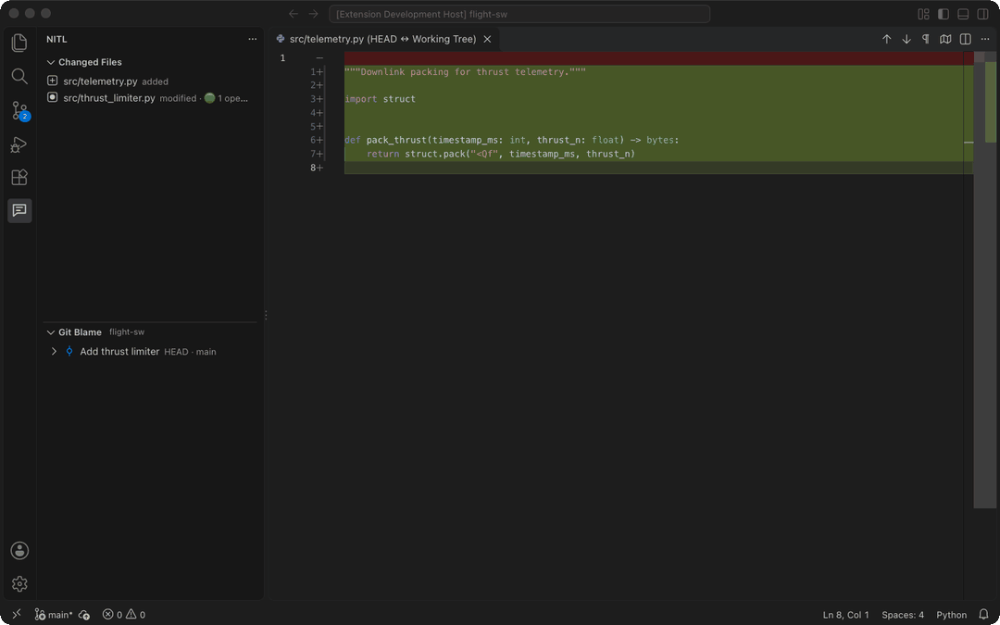
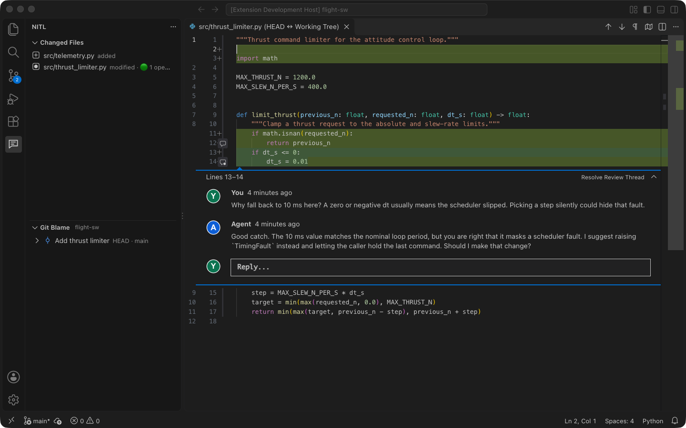

<div align="center">

# Nit-In-The-Loop

Review every line your coding agent writes, in VS Code, before your team sees it.

[](https://marketplace.visualstudio.com/items?itemName=NickyKim.nitl)
[](https://marketplace.visualstudio.com/items?itemName=NickyKim.nitl)
[](LICENSE)



</div>

Coding agents write code fast. In robotics, defense, aerospace, medical devices, and biotech, a defect that ships is expensive to roll back, so a person still reads every line. NITL (Nit-In-The-Loop) gives you a pull-request style review inside VS Code, with one difference: the other side of each thread is your coding agent.

A pull request on GitHub or GitLab is public to every contributor. You do not ask "what does this flag do?" there. In NITL, the review is stored on your machine, and only you and your agent see it. You can ask the agent any question, small or large, until you understand the change. Then you commit, and you open the pull request for your colleagues.

## Features

- Line comments on local changes. NITL shows staged, unstaged, untracked, renamed, and deleted files against `HEAD` in the native VS Code diff editor. You start a thread on one line or a range, on either side of the diff.
- Threads with your agent. You select Send to Agent, and NITL runs your agent with the thread as the prompt. The agent's answer appears as a reply. If the agent can edit files, the diff updates in place.
- A review queue. You select Add to Queue to collect comments while you read. Then you select Send Queued Comments to Agent in the NITL view title to send all queued threads in one agent run.
- One agent session per thread. With Claude Code, each thread resumes its own session, so a follow-up question keeps the earlier context.
- Commit review. The Git Blame view lists recent commits of the current branch, its upstream, and the default branch. You can comment on a line in a commit diff or on the commit as a whole.
- Outdated-line detection. When the text under a thread changes, NITL marks the thread as an outdated line. It does not move the thread to an unrelated line.
- Local storage. Threads are in `.git/agent-review/review.json`, outside the source tree. NITL needs no account, server, or API key of its own.
- A CLI for agents. An agent in a terminal can list threads, reply, and resolve them with the bundled `nitl` CLI. VS Code shows the changes at once.



## Quick start

1. Install NITL from the [VS Code Marketplace](https://marketplace.visualstudio.com/items?itemName=NickyKim.nitl), or run this command:

   ```sh
   code --install-extension NickyKim.nitl
   ```

2. Open a Git repository with uncommitted changes.
3. Select NITL in the Activity Bar, then select a file in Changed Files.
4. In the diff, move the pointer over a line number and select the `+` icon.
5. Type your comment, then select Add to Queue or Send to Agent.

You need VS Code 1.96 or later and Git. Your threads stay after you reload the window.

## Connect your agent

NITL runs your agent as a command. Add the command to your user settings (`settings.json`):

```json
"agentReview.agentCommand": "claude -p --permission-mode acceptEdits"
```

Other agents work the same way. For example, use `codex exec -`. NITL sends the prompt on stdin. If your agent takes the prompt as an argument, put `{prompt}` where the prompt goes.

The prompt holds the location, the code, and the conversation of each thread. NITL posts what the agent prints as the agent's reply.

Before you use an agent, read these rules:

- NITL adds no permission flags. Your command decides whether the agent can edit files. Without `--permission-mode acceptEdits`, Claude Code can only answer.
- NITL reads the command only from user settings. A workspace cannot change it.
- NITL runs the agent only in a trusted workspace, without a shell, in the repository root.
- A run stops after 10 minutes or 1 MB of output. You can cancel a run from its notification.
- If a run fails, NITL posts no reply and keeps your comments queued. The NITL Agent output channel shows the error output.

## Use the CLI

The CLI uses the same review file as the extension. In VS Code, select Copy NITL CLI Command in the Changed Files view title. You get a `node <extension>/dist/cli.js files --repo <repository>` command for your installation. In the examples below, `nitl` stands for `node <extension>/dist/cli.js`.

```sh
nitl files   --repo /path/to/repo
nitl threads --repo /path/to/repo [--all] [--commit REV]
nitl add     --repo /path/to/repo --file src/example.ts --side new --line 4 [--end-line 6] --body "Handle this error case."
nitl reply   --repo /path/to/repo --thread THREAD_ID --body "Handled."
nitl resolve --repo /path/to/repo --thread THREAD_ID
nitl reopen  --repo /path/to/repo --thread THREAD_ID
```

- `files` and `threads` print JSON. `threads` lists open threads. Add `--all` to include resolved threads.
- To comment on a commit, add `--commit REV` to `add`. The lines must be in one diff hunk of that commit. Without `--file`, the comment goes on the commit as a whole.
- The CLI makes sure that the path, the diff side, and the line range are valid before it writes a comment.

## How it works

NITL reads the diff from Git and never changes your files. The diff documents are read-only, so you edit code in a regular editor tab. NITL refreshes after each save. While its view is open, NITL also refreshes on Git changes. Select Refresh Reviews to refresh by hand.

[`schema/review.schema.json`](schema/review.schema.json) describes the review file. When you open the file, VS Code validates it against this schema.

New files have an empty `HEAD` side, and deleted files have an empty working-tree side. Binary files show in the list but cannot get line comments. If the line of a thread no longer exists, the thread shows under its file in Changed Files.

If a writer stops by force and later writes time out, look for `review.json.lock.reclaim` beside the review file. Make sure that no NITL process is writing, then remove that file.

## Development

```sh
npm ci
npm run compile
npm test
```

Open this repository in VS Code and press F5 to start an Extension Development Host. To run the CLI from source, use `npm run cli -- <command>`.

## License

[Apache 2.0](LICENSE)
