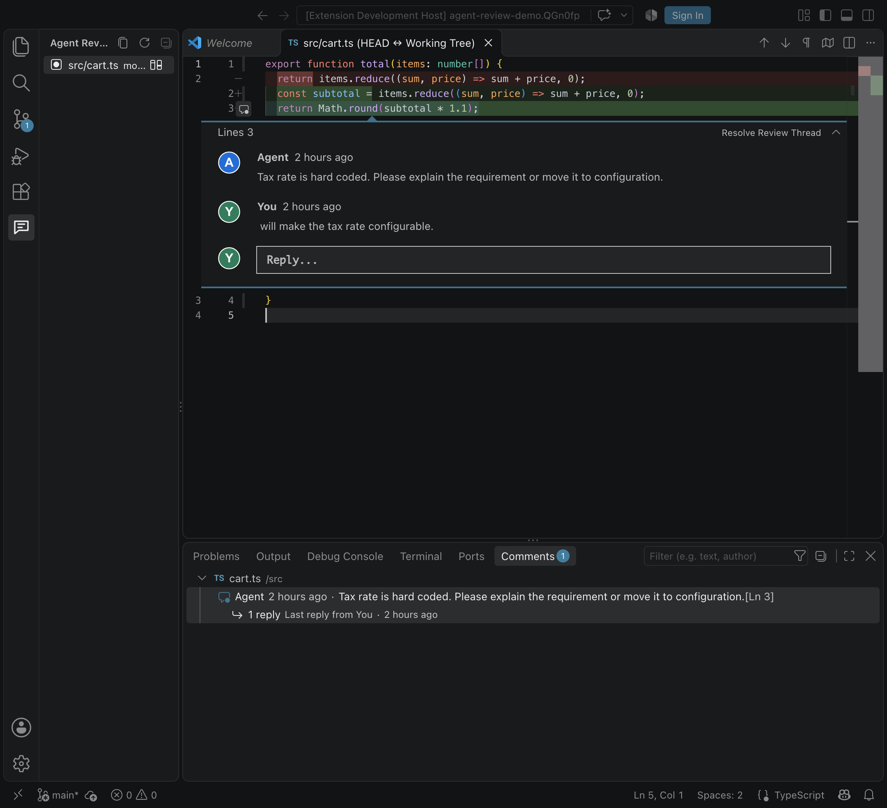

# Nit-In-The-Loop

Review local Git changes with line comments inside VS Code. Open a diff, share a thread with a coding agent through the bundled CLI, and resolve it when the work is done.



## What you can do

- **Review the working tree.** See staged, unstaged, untracked, deleted, and renamed files against `HEAD` in VS Code's native diff editor.
- **Inspect Git history.** The Git Blame view lists recent commits across branches, marks branch tips and `HEAD`, and colors commits by branch. Expand a commit to see its changed files and open a diff. Choose **Show Git Blame** on a changed file to inspect its committed lines.
- **Comment on exact lines.** Start a thread on either side of the diff, reply inline, and resolve or reopen it. Threads also appear in the Comments panel.
- **Exchange comments with an agent.** The bundled CLI lets any agent that can run a command list files and threads, add comments, reply, and change thread status. CLI updates appear in VS Code automatically.
- **Keep reviews local.** Threads are stored in `agent-review/review.json` under the repository's Git directory, outside the source tree. The extension and CLI need no account or API key.

[Light theme](docs/screenshots/agent-review-light.png) · [Open thread](docs/screenshots/agent-review-open-status.png) · [Resolved status](docs/screenshots/agent-review-resolved-status.png)

## Get started

1. **Install the tools:** [VS Code](https://code.visualstudio.com/) 1.96 or newer, Git, and Node.js/npm.
2. **Start NITL:** Run `npm ci && npm run compile` in this repository, open it in VS Code, then press **F5**. A new Extension Development Host window opens.
3. **Leave a comment:** In that window, open a Git repository with a changed text file. Click **NITL** in the Activity Bar, select a file, then use **Add Comment** on a line in the diff.

Reply or resolve the thread inline. Your comments are restored when you reload the window.

## Work with an agent

The CLI shares the extension's review store. From this source checkout, use `npm run cli --`:

```sh
npm run cli -- files --repo /path/to/repo
npm run cli -- threads --repo /path/to/repo
npm run cli -- add --repo /path/to/repo --file src/example.ts --side new --line 4 --body "Please handle this error case."
npm run cli -- reply --repo /path/to/repo --thread THREAD_ID --body "Handled."
npm run cli -- resolve --repo /path/to/repo --thread THREAD_ID
npm run cli -- reopen --repo /path/to/repo --thread THREAD_ID
```

`files` and `threads` return JSON. `threads` lists open threads by default; add `--all` to include resolved threads. For a range comment, add `--end-line NUMBER` to `add`. The CLI validates paths, diff sides, and line ranges before writing a comment.

For an installed VSIX, choose **Copy NITL CLI Command** from the NITL view title or the Command Palette. It copies a `node <extension>/dist/cli.js files --repo <repository>` command that uses the installed extension, so the source checkout is unnecessary. Replace `files` with another command above and supply its options. The extension refreshes when the CLI changes the review store.

The current release exchanges comments through this CLI. It does not launch Claude, Codex, or another agent from the VS Code UI.

## Review behavior

Diff documents are read-only. Edit the real file in a regular editor; NITL refreshes after saves and checks for external Git changes while its view is visible. Use **Refresh Reviews** when needed.

New files have an empty `HEAD` side; deleted files have an empty working-tree side. Renames read their old path from `HEAD`. Binary files appear in the list but cannot receive line comments. When a thread's original text changes, it is marked **Outdated line**. If its line no longer exists, the thread appears under the file in Changed Files instead of being placed on an unrelated line.

If a writer is forcibly stopped and later writes time out, check for `review.json.lock.reclaim` beside the review file. Remove that guard only after confirming no NITL process is writing.

## Development

```sh
npm ci
npm run compile
npm test
```

The launch configuration in `.vscode/launch.json` starts the Extension Development Host.
